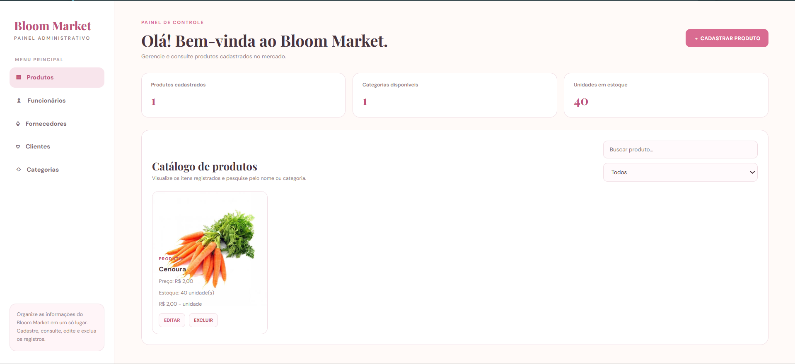
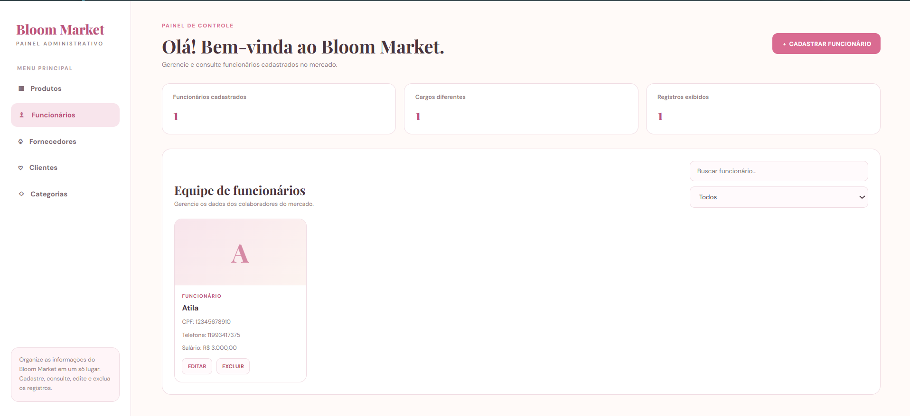
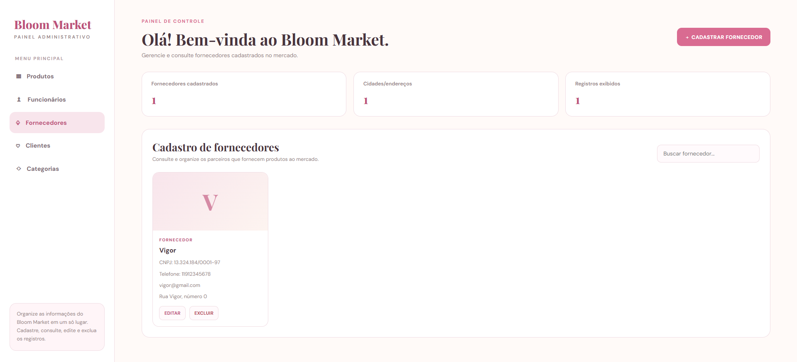
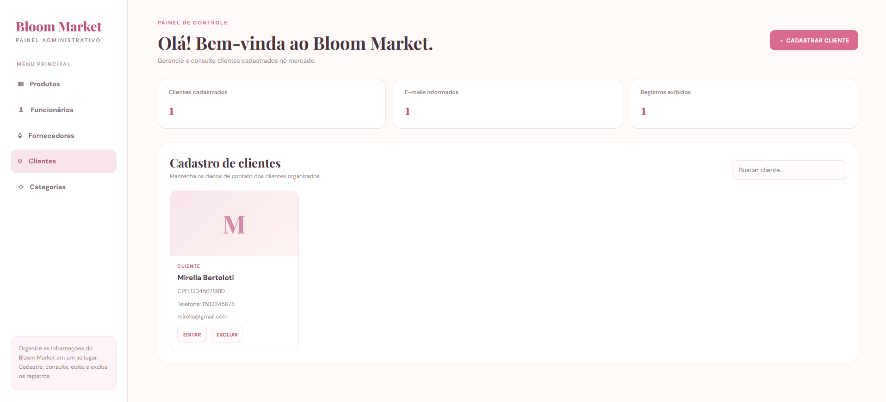
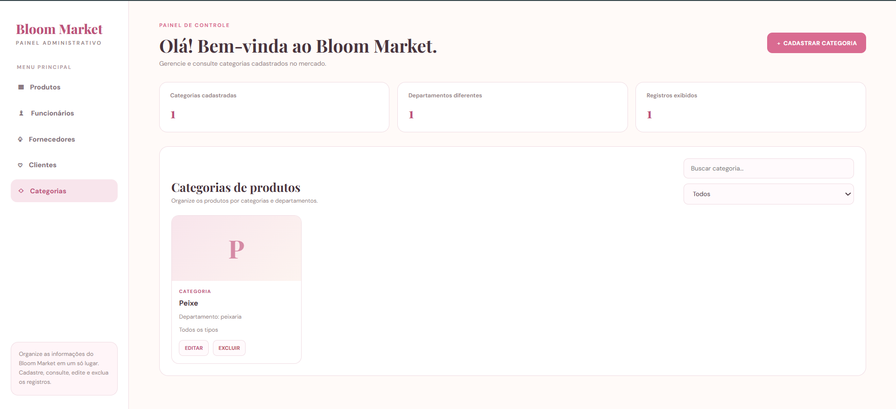

# 🌸 Bloom Market

### Sistema de gerenciamento de supermercado

## Sobre o projeto

O **Bloom Market** é um sistema desenvolvido com o objetivo de facilitar o gerenciamento de informações de um supermercado. A aplicação permite organizar e administrar dados de produtos, funcionários, fornecedores, clientes e categorias.

O projeto possui uma interface visual simples e intuitiva, com foco na organização e facilidade de utilização.

## Objetivo

Desenvolver um sistema que auxilie no gerenciamento das informações de um supermercado, permitindo o cadastro, a consulta, a atualização e a exclusão de registros.

## Funcionalidades

O sistema conta com cinco entidades principais:

- **Produtos:** cadastro e gerenciamento dos produtos disponíveis no supermercado.
  
- **Funcionários:** armazenamento de informações dos colaboradores.
  
- **Fornecedores:** gerenciamento dos dados dos fornecedores.
  
- **Clientes:** armazenamento das informações dos clientes.
  
- **Categorias:** organização e classificação dos produtos.
  


As operações disponíveis na API incluem:

- Cadastrar registros.
- Listar registros cadastrados.
- Buscar registros pelo ID.
- Atualizar informações.
- Excluir registros.

## Tecnologias utilizadas

### Front-end
- HTML
- CSS
- JavaScript

### Back-end
- Java
- Spring Boot
- Spring Web
- Spring Data JPA

### Banco de dados
- MySQL Workbench


## Estrutura de Pastas

```text
supermarket/
│
├── src/
|   ├── images/
|   |
│   ├── main/
│   │   ├── java/com/dt2/supermarket/
│   │   │   │
│   │   │   ├── controller/
│   │   │   │   ├── CategoriaController.java
│   │   │   │   ├── ClienteController.java
│   │   │   │   ├── FornecedorController.java
│   │   │   │   ├── FuncionarioController.java
│   │   │   │   └── ProdutoController.java
│   │   │   │
│   │   │   ├── entities/
│   │   │   │   ├── Categoria.java
│   │   │   │   ├── Cliente.java
│   │   │   │   ├── Fornecedor.java
│   │   │   │   ├── Funcionario.java
│   │   │   │   └── Produto.java
│   │   │   │
│   │   │   ├── repository/
│   │   │   │   ├── CategoriaRepository.java
│   │   │   │   ├── ClienteRepository.java
│   │   │   │   ├── FornecedorRepository.java
│   │   │   │   ├── FuncionarioRepository.java
│   │   │   │   └── ProdutoRepository.java
│   │   │   │
│   │   │   └── SupermarketApplication.java
│   │   │
│   │   └── resources/
│   │       ├── static/
│   │       │   ├── css/
│   │       │   │   └── style.css
│   │       │   │
│   │       │   └── js/
│   │       │       └── script.js
│   │       │
│   │       ├── templates/
│   │       │   └── index.html
│   │       │
│   │       └── application.properties
│   │
│   └── test/
│       └── java/com/dt2/supermarket/
│           └── SupermarketApplicationTest.java
│
├── .mvn/wrapper
│   └── maven-wrapper.properties
│
├── mvnw
├── mvnw.cmd
├── pom.xml
├── .gitattributes
├── .gitignore
└── README.md
```


## Endpoints da API

A API utiliza os seguintes caminhos:

| Entidade | Endpoint |
|---|---|
| Produtos | `/api/produtos` |
| Funcionários | `/api/funcionarios` |
| Fornecedores | `/api/fornecedores` |
| Clientes | `/api/clientes` |
| Categorias | `/api/categorias` |

Cada entidade possui operações de cadastro, consulta, atualização e exclusão.

## Endpoints e métodos HTTP

A API REST do Bloom Market utiliza os métodos HTTP para realizar operações de gerenciamento de dados, seguindo o padrão CRUD (Create, Read, Update e Delete).

Cada entidade possui endpoints específicos para realizar operações de cadastro, consulta, atualização e exclusão.

### Métodos HTTP utilizados

| Método | Operação | Descrição |
|---|---|---|
| GET | Read | Consulta e retorna os registros cadastrados. |
| POST | Create | Cadastra um novo registro no sistema. |
| PUT | Update | Atualiza as informações de um registro existente. |
| DELETE | Delete | Exclui um registro utilizando seu identificador (ID). |

### Endpoints por entidade

A API possui cinco entidades principais: Produtos, Funcionários, Fornecedores, Clientes e Categorias.

#### 1. Produtos

Endpoint base: `/api/produtos`

| Método | Endpoint | Descrição |
|---|---|---|
| GET | `/api/produtos` | Lista todos os produtos cadastrados. |
| GET | `/api/produtos/{id}` | Busca um produto específico pelo ID. |
| POST | `/api/produtos` | Cadastra um novo produto. |
| PUT | `/api/produtos/{id}` | Atualiza os dados de um produto existente. |
| DELETE | `/api/produtos/{id}` | Exclui um produto pelo ID. |

#### 2. Funcionários

Endpoint base: `/api/funcionarios`

| Método | Endpoint | Descrição |
|---|---|---|
| GET | `/api/funcionarios` | Lista todos os funcionários. |
| GET | `/api/funcionarios/{id}` | Busca um funcionário pelo ID. |
| POST | `/api/funcionarios` | Cadastra um novo funcionário. |
| PUT | `/api/funcionarios/{id}` | Atualiza os dados de um funcionário. |
| DELETE | `/api/funcionarios/{id}` | Exclui um funcionário. |

#### 3. Fornecedores

Endpoint base: `/api/fornecedores`

| Método | Endpoint | Descrição |
|---|---|---|
| GET | `/api/fornecedores` | Lista todos os fornecedores. |
| GET | `/api/fornecedores/{id}` | Busca um fornecedor pelo ID. |
| POST | `/api/fornecedores` | Cadastra um novo fornecedor. |
| PUT | `/api/fornecedores/{id}` | Atualiza os dados de um fornecedor. |
| DELETE | `/api/fornecedores/{id}` | Exclui um fornecedor. |

#### 4. Clientes

Endpoint base: `/api/clientes`

| Método | Endpoint | Descrição |
|---|---|---|
| GET | `/api/clientes` | Lista todos os clientes. |
| GET | `/api/clientes/{id}` | Busca um cliente pelo ID. |
| POST | `/api/clientes` | Cadastra um novo cliente. |
| PUT | `/api/clientes/{id}` | Atualiza os dados de um cliente. |
| DELETE | `/api/clientes/{id}` | Exclui um cliente. |

#### 5. Categorias

Endpoint base: `/api/categorias`

| Método | Endpoint | Descrição |
|---|---|---|
| GET | `/api/categorias` | Lista todas as categorias. |
| GET | `/api/categorias/{id}` | Busca uma categoria pelo ID. |
| POST | `/api/categorias` | Cadastra uma nova categoria. |
| PUT | `/api/categorias/{id}` | Atualiza uma categoria existente. |
| DELETE | `/api/categorias/{id}` | Exclui uma categoria. |

### Exemplos de utilização

Considerando que a API esteja sendo executada localmente na porta 8080:

**Cadastrar um produto (POST)**

`POST http://localhost:8080/api/produtos`

Exemplo de corpo da requisição (JSON):

```json
{
  "nome": "Arroz",
  "preco": 25.90
}
```

*Os campos são ilustrativos e devem ser ajustados aos atributos definidos na entidade Produto.*

**Listar produtos (GET)**

`GET http://localhost:8080/api/produtos`

Retorna a lista de produtos cadastrados.

**Buscar produto por ID (GET)**

`GET http://localhost:8080/api/produtos/1`

Retorna os dados do produto que possui o identificador 1.

**Atualizar produto (PUT)**

`PUT http://localhost:8080/api/produtos/1`

Permite modificar as informações do produto selecionado.

**Excluir produto (DELETE)**

`DELETE http://localhost:8080/api/produtos/1`

Remove o produto correspondente ao identificador informado.

### Operações CRUD

As operações CRUD permitem que o sistema realize o gerenciamento completo das informações armazenadas no banco de dados:

- Create: criação de novos registros por meio do método POST.
- Read: leitura e consulta de registros por meio do método GET.
- Update: atualização de registros por meio do método PUT.
- Delete: exclusão de registros por meio do método DELETE.


## Como executar o projeto

1. Abra o projeto do back-end no IntelliJ IDEA.
2. Verifique se as dependências do Spring Boot estão configuradas.
3. Configure a conexão com o banco de dados.
4. Execute a aplicação Spring Boot.
5. Com o back-end em execução, a interface poderá realizar as requisições para a API.

**Endereço da API:**

```text
http://localhost:8080
```

## Identidade visual

O Bloom Market possui uma identidade visual inspirada em tons de rosa e cores suaves, buscando transmitir uma aparência delicada, moderna e organizada.

A interface foi desenvolvida com HTML, CSS e JavaScript, mantendo os arquivos separados para facilitar a manutenção e a organização do código.

## Considerações finais

O Bloom Market é um projeto acadêmico desenvolvido para aplicar conhecimentos de programação, desenvolvimento web, orientação a objetos, criação de APIs e integração com banco de dados.

A proposta é construir uma aplicação organizada e funcional, permitindo a prática dos conceitos estudados durante o desenvolvimento de sistemas.
