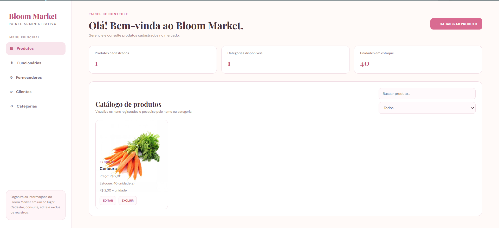
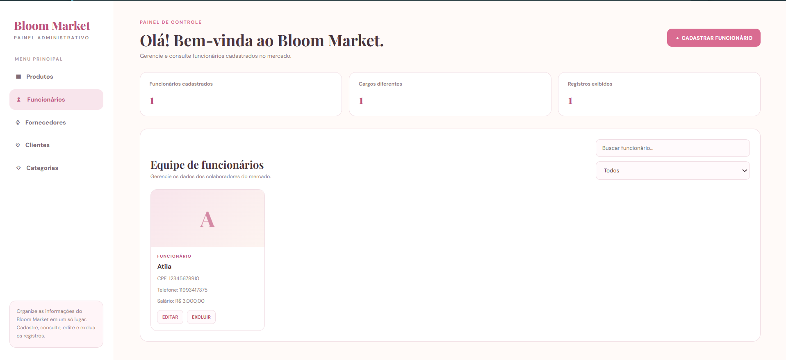
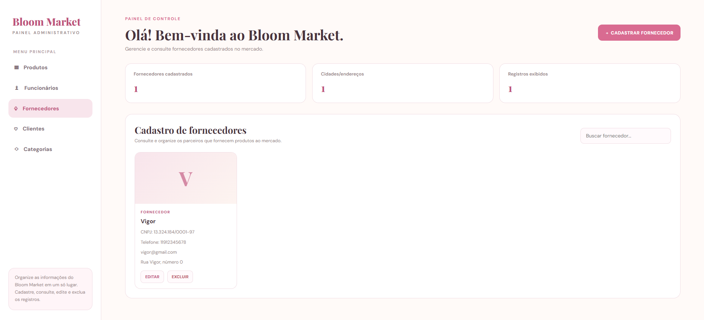
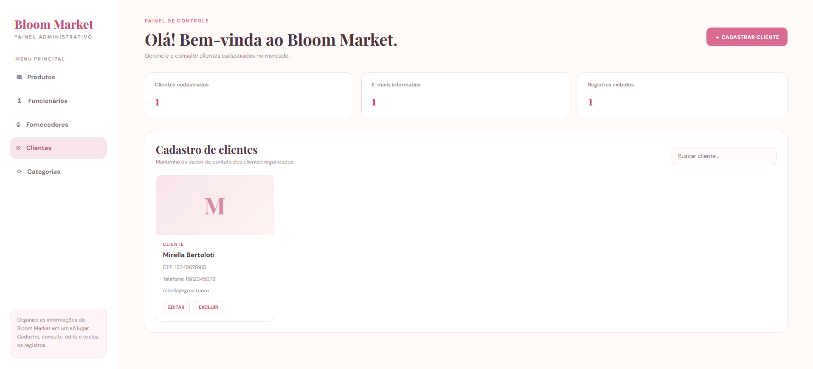
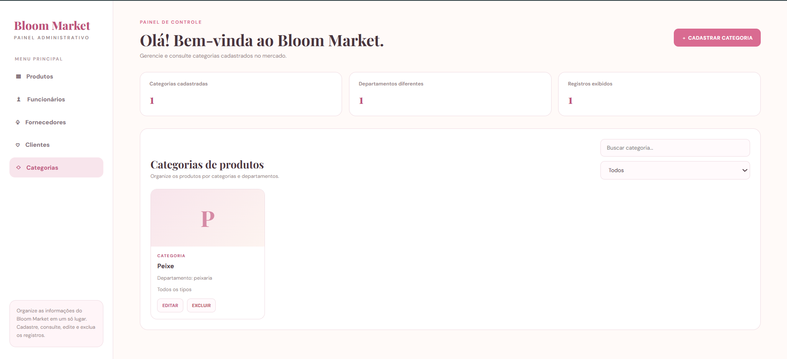

# 🌸 Bloom Market

### Sistema de gerenciamento de supermercado

## Sobre o projeto

O **Bloom Market** é um sistema desenvolvido com o objetivo de facilitar o gerenciamento de informações de um supermercado. A aplicação permite organizar e administrar dados de produtos, funcionários, fornecedores, clientes e categorias.

O projeto possui uma interface visual simples e intuitiva, com foco na organização e facilidade de utilização.

## Objetivo

Desenvolver um sistema que auxilie no gerenciamento das informações de um supermercado, permitindo o cadastro, a consulta, a atualização e a exclusão de registros.

## Funcionalidades

O sistema conta com cinco entidades principais:

- **Produtos:** cadastro e gerenciamento dos produtos disponíveis no supermercado.
  
- **Funcionários:** armazenamento de informações dos colaboradores.
  
- **Fornecedores:** gerenciamento dos dados dos fornecedores.
  
- **Clientes:** armazenamento das informações dos clientes.
  
- **Categorias:** organização e classificação dos produtos.
  


As operações disponíveis na API incluem:

- Cadastrar registros.
- Listar registros cadastrados.
- Buscar registros pelo ID.
- Atualizar informações.
- Excluir registros.

## Tecnologias utilizadas

### Front-end
- HTML
- CSS
- JavaScript

### Back-end
- Java
- Spring Boot
- Spring Web
- Spring Data JPA

### Banco de dados
- MySQL Workbench


## Endpoints da API

A API utiliza os seguintes caminhos:

| Entidade | Endpoint |
|---|---|
| Produtos | `/api/produtos` |
| Funcionários | `/api/funcionarios` |
| Fornecedores | `/api/fornecedores` |
| Clientes | `/api/clientes` |
| Categorias | `/api/categorias` |

Cada entidade possui operações de cadastro, consulta, atualização e exclusão.

## Como executar o projeto

1. Abra o projeto do back-end no IntelliJ IDEA.
2. Verifique se as dependências do Spring Boot estão configuradas.
3. Configure a conexão com o banco de dados.
4. Execute a aplicação Spring Boot.
5. Com o back-end em execução, a interface poderá realizar as requisições para a API.

**Endereço da API:**

```text
http://localhost:8080
```

## Identidade visual

O Bloom Market possui uma identidade visual inspirada em tons de rosa e cores suaves, buscando transmitir uma aparência delicada, moderna e organizada.

A interface foi desenvolvida com HTML, CSS e JavaScript, mantendo os arquivos separados para facilitar a manutenção e a organização do código.

## Considerações finais

O Bloom Market é um projeto acadêmico desenvolvido para aplicar conhecimentos de programação, desenvolvimento web, orientação a objetos, criação de APIs e integração com banco de dados.

A proposta é construir uma aplicação organizada e funcional, permitindo a prática dos conceitos estudados durante o desenvolvimento de sistemas.